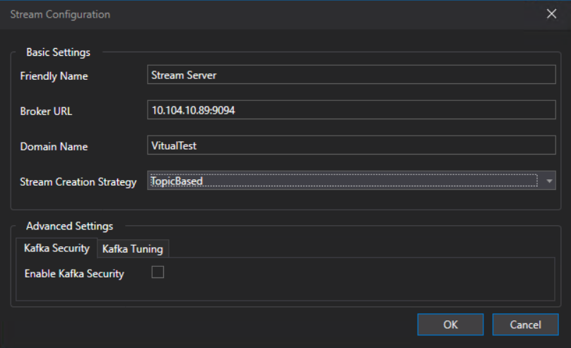
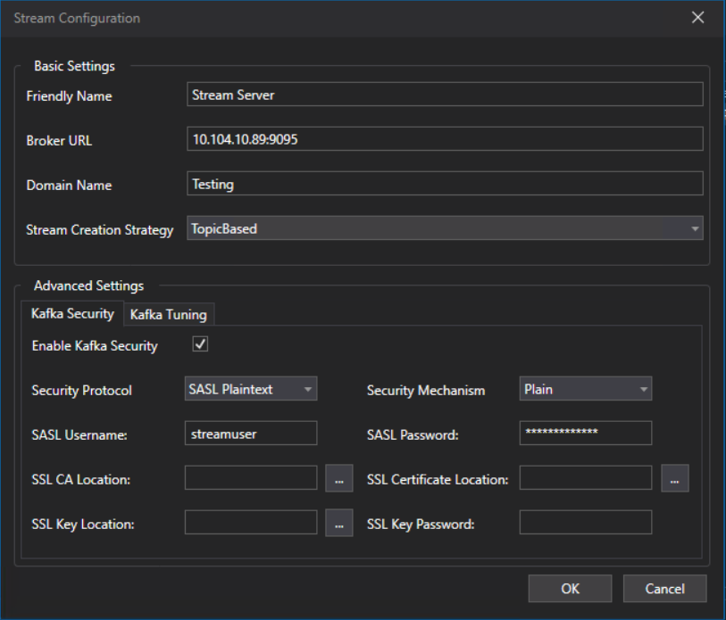
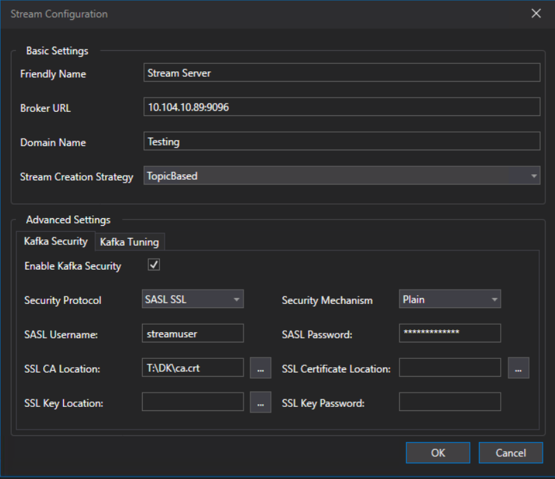
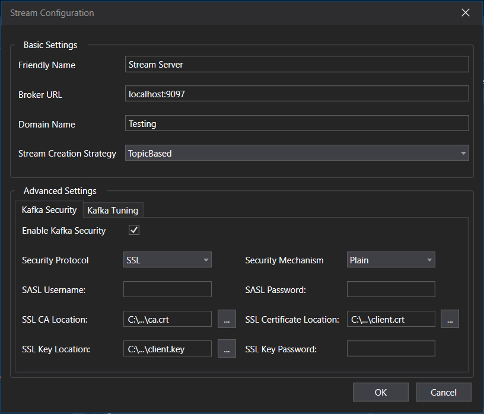
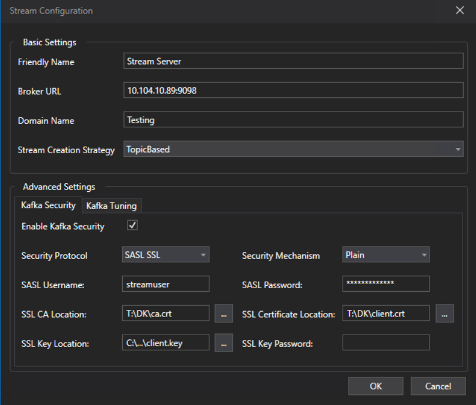
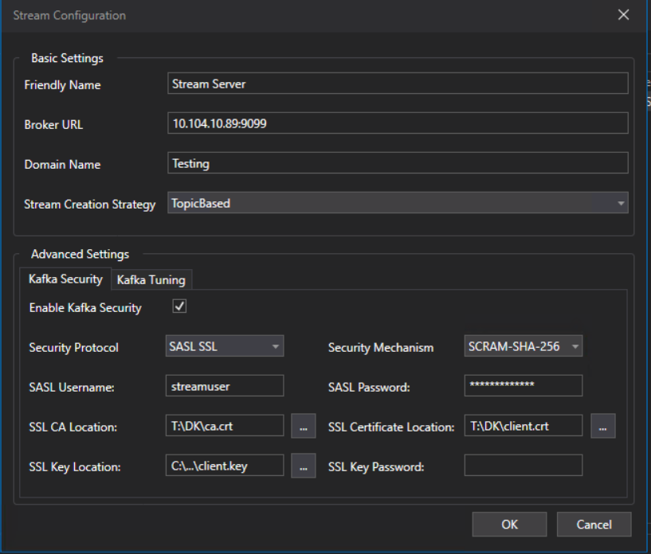

# Unified Broker

A centralized Kafka broker for Docker Swarm. One Kafka stack exposes **every supported
security posture on its own port at the same time**, so the broker is deployed once and
a client moves between postures by changing only its own configuration.

The Bridge Service runs as a Docker container on a **separate VM**. ADS streams raw
telemetry to it on port `9697`, and the Bridge decodes it and publishes to Kafka on
whichever secured port it is configured for.

For how this compares to the [Fragmented Broker](../Fragmented%20Broker/) approach, see
the [Virtual Machine Streaming README](../README.md).

---

## Architecture

```
 Windows machine                 Bridge VM (role=bridge)                Kafka VM (role=kafka, 10.104.10.89)
┌──────────────┐  9697/TCP   ┌───────────────────────────┐  9094–9099  ┌────────────────────────────┐
│     ADS      │───────────► │ bridge-service            │───────────► │ kafka                      │
│ (remote data │             │ virtual-parameter-service │             │   9094 plaintext           │
│   feed)      │             │ gateway-service           │             │   9095–9099 secured        │
└──────────────┘             │ config/file indexers      │             │ kafka-ui  :8080            │
                             │ mongodb                   │             └─────────────┬──────────────┘
                             └───────────────────────────┘                           │
                                                                                     ▼
                                                                      ATLAS Stream Recorder
                                                                      (10.104.10.89:<port>)
```

| Hop | From → To | Address | Configured in |
|---|---|---|---|
| Raw telemetry | ADS → Bridge | `<bridge-VM-IP>:9697` | ADS → Tools → Options → Recording → **Remote data feed endpoint** |
| Engineering data | Bridge / VPS / Gateway → Kafka | `10.104.10.89:<port>` | `StreamApiConfig__BrokerUrl` in `docker-compose.bridge-secure.yml` |
| Consumption | ATLAS → Kafka | `10.104.10.89:<port>` | ATLAS Stream Configuration dialog |

### Which Bridge deployment this is

Bridge Service is the same program in all three deployments. The only difference is how
it starts, and therefore which configuration it reads:

| How Bridge Service runs | Configuration it reads | Used here? |
|---|---|---|
| Launched by ADS | `Documents\McLaren Electronic Systems\ATLAS 9\BridgeService\BridgeServiceConfig.json` | No |
| Standalone on Windows (`MA.DataPlatforms.Bridge.Host.exe`) | `Configs\AppConfig.json` next to the exe, or the file passed with `-c` | No |
| **Docker** (`atlasplatformdocker/bridge-service-host`) | `/app/Configs/AppConfig.json` in the container, or the file named by `CONFIG_FILE_PATH` | **Yes** |

This stack uses the **Docker** deployment. It mounts no `AppConfig.json`; every setting
is supplied as an environment variable in `docker-compose.bridge-secure.yml`.
Environment variables override the image's built-in `AppConfig.json`. Nested keys use
`__`, for example `StreamApiConfig__Security__SaslUsername`.

---

## Folder Contents

| File | Purpose |
|---|---|
| `docker-compose.kafka-secure.yml` | Swarm stack for the **Kafka VM**: the broker with all listeners, plus Kafka UI. |
| `docker-compose.bridge-secure.yml` | Swarm stack for the **Bridge VM**: Bridge Service, Virtual Parameter Service, Gateway Service, file and config indexers, and MongoDB. Ships on posture 2 (SASL/PLAIN over TLS, port `9096`). |
| `docker-compose.local-preflight.yml` | The same broker for plain `docker compose` on one machine, advertising `localhost`. Optional: use it to test a broker change before it reaches the Swarm. |
| `generate-certs.sh` / `generate-certs.ps1` | Create the CA, the broker keystore and truststore, and the client certificates in `./secrets`. They also copy `kafka_server_jaas.conf` into `./secrets`. |
| `create-scram-users.sh` | Creates the SCRAM-SHA-256 users. Needed for posture 5 only. |
| `kafka_server_jaas.conf` | Broker JAAS entry for the SCRAM listener. Kafka will not start a SCRAM listener without it. |
| `.gitignore` | Keeps the generated `secrets/` directory out of git. |
| `Port9094.png` … `Port9099.png` | ATLAS Stream Configuration screenshots, one for each port. |

---

## Port Map

The broker publishes ports `9094` to `9099` on the Kafka VM and advertises them as
`10.104.10.89:<port>`. The same address therefore works for clients both inside and
outside the Swarm.

| Port | Listener | Protocol | SASL mechanism | Client cert | Posture | Reachable from |
|---|---|---|---|---|---|---|
| 9092 | `PLAINTEXT` | PLAINTEXT | — | — | inter-broker | overlay only (`kafka:9092`) |
| 9093 | `CONTROLLER` | PLAINTEXT | — | — | KRaft controller | container only |
| 9094 | `PLAINTEXT_HOST` | PLAINTEXT | — | — | unsecured | `10.104.10.89:9094` |
| 9095 | `SASLPLAIN` | SASL_PLAINTEXT | PLAIN | no | 1 | `10.104.10.89:9095` |
| 9096 | `SASLSSL` | SASL_SSL | PLAIN | no | **2 (default)** | `10.104.10.89:9096` |
| 9097 | `MTLS` | SSL | — | **required** | 3 | `10.104.10.89:9097` |
| 9098 | `SASLMTLS` | SASL_SSL | PLAIN | **required** | 4 | `10.104.10.89:9098` |
| 9099 | `SCRAMMTLS` | SASL_SSL | SCRAM-SHA-256 | **required** | 5 | `10.104.10.89:9099` |

A Kafka client uses the broker URL only for its first connection. Every later
connection goes to the address the broker **advertises** for that listener. For that
reason all three of the following must use the same Kafka VM address:

1. `KAFKA_ADVERTISED_LISTENERS` in `docker-compose.kafka-secure.yml`
2. The broker certificate SAN, set with `KAFKA_NODE_IP` when you run `generate-certs`
3. `StreamApiConfig__BrokerUrl` in `docker-compose.bridge-secure.yml`, and the ATLAS
   **Broker URL**

> **If the Kafka VM is not `10.104.10.89`:** replace the address in
> `docker-compose.kafka-secure.yml` (six advertised listeners and the `local-saslssl`
> Kafka UI cluster) and in `docker-compose.bridge-secure.yml` (three `BrokerUrl` values).
> Then regenerate the certificates with `KAFKA_NODE_IP=<new-ip>`.

---

## Prerequisites

**1. Two VMs in one Docker Swarm, with labels.** Every service is pinned with a
placement constraint. A service whose label is missing stays `Pending` and shows no
error.

```bash
docker node update --label-add role=kafka  <kafka-node>
docker node update --label-add role=bridge <bridge-node>
```

**2. The shared overlay network.** Both stacks declare it as `external`, so you must
create it once, on a manager node:

```bash
docker network create --driver overlay --attachable shared_network
```

**3. Firewall.**

| Open on | Port(s) | For |
|---|---|---|
| Kafka VM | `9094`–`9099/tcp` | Bridge, VPS, Gateway and ATLAS |
| Kafka VM | `8080/tcp` | Kafka UI in a browser |
| Bridge VM | `9697/tcp` | ADS remote data feed |
| Bridge VM | `10010/tcp`, `10011/tcp`, `5200/tcp` | Bridge metrics, VPS metrics, Gateway gRPC |
| All Swarm nodes | `2377/tcp`, `7946/tcp+udp`, `4789/udp` | Swarm management and the overlay network |

**4. CIFS on the Bridge VM.** `cifs-utils` must be installed, and the VM must be able to
reach `//vmmcafilappp01.applied.com/Files`. The Bridge, the file indexer and the config
indexer all read PGVs, config and PUL files from that share, mounted at `/tdrive`.

---

## Setup

### 1. Generate certificates (once)

Run anywhere that has `openssl` and `docker`. A laptop is fine.

```bash
./generate-certs.sh
```

Windows PowerShell:

```powershell
$env:OPENSSL_CONF = "C:\Program Files\Git\mingw64\etc\ssl\openssl.cnf"
.\generate-certs.ps1
```

> You need the `OPENSSL_CONF` line if Strawberry Perl is installed. PowerShell finds
> Strawberry's `openssl.exe` before Git's, and that build fails on the first command.
> To check which one is found, run `Get-Command openssl -All`.

Check that the SAN covers the Kafka VM:

```bash
openssl x509 -in secrets/kafka.crt -noout -text | grep -A1 "Subject Alternative Name"
# DNS:kafka, DNS:localhost, IP Address:127.0.0.1, IP Address:10.104.10.89
```

To use a different Kafka VM IP, or extra names, set them when you generate:

```bash
KAFKA_NODE_IP=10.104.10.90 EXTRA_SANS="DNS:kafka.internal" ./generate-certs.sh
```

A missing SAN entry is the most likely cause of a TLS failure that looks like a broker
fault. Don't fix it by turning off hostname verification.

### 2. Stage certificates on both VMs

Swarm doesn't copy local files to remote nodes. If the absolute path is missing on the
node, the container sees an empty directory.

**Kafka VM:** copy the whole folder, owned by uid 1000:

```bash
scp -r secrets ocsautotest@<kafka-node>:/home/ocsautotest/docker-composes/Kafka/
ssh ocsautotest@<kafka-node> \
  'sudo mkdir -p /home/ocsautotest/docker-composes/Kafka/data && \
   sudo chown -R 1000:1000 /home/ocsautotest/docker-composes/Kafka'
```

**Bridge VM:** needs `ca.crt`, plus `client.crt` and `client.key` for postures 3–5:

```bash
scp -r secrets ocsautotest@<bridge-node>:/home/ocsautotest/docker-composes/Bridge/
```

**ATLAS machine:** copy `ca.crt`, plus `client.crt` and `client.key` for postures 3–5,
to a local folder. You will point the Stream Configuration dialog at that folder.

### 3. Deploy the Kafka stack

From a manager node:

```bash
docker stack deploy -c docker-compose.kafka-secure.yml kafka
docker service logs -f kafka_kafka
```

Wait for a `Kafka Server started` line. Then open Kafka UI at
`http://10.104.10.89:8080`, where two clusters appear:

- **local-plaintext** (`kafka:9092`): the unauthenticated view
- **local-saslssl** (`10.104.10.89:9096`): shows that TLS and SASL work before any
  application is involved

### 4. Create SCRAM users (posture 5 only)

Run this **on the Kafka VM** after the stack is up:

```bash
./create-scram-users.sh
```

This works because the internal `PLAINTEXT` listener on `kafka:9092` doesn't need
authentication, so it can create the first SCRAM users.

### 5. Deploy the Bridge stack

The T-drive credentials are read from the shell environment, so they are never written
into the file. `docker stack deploy` refuses to run if either variable is unset.

```bash
export CIFS_USERNAME='ocs.autotest@applied.com'
export CIFS_PASSWORD='<password>'
docker stack deploy -c docker-compose.bridge-secure.yml bridge
docker service logs -f bridge_bridge-service
```

> The CIFS volume is created the first time a task lands on the Bridge VM. If you deploy
> with the wrong credentials, remove the stack, run `docker volume rm bridge_t_drive`
> on the Bridge VM, then deploy again.

### 6. Point ADS at the Bridge VM

On the ADS machine, open **Tools → Options → Recording** and set:

| Setting | Value |
|---|---|
| Enable remote data feed | `TRUE` |
| Remote data feed endpoint | `<bridge-VM-IP>:9697` (the default `[::1]:9697` means the local machine) |

If ADS also has **Local Bridge Service** set to `TRUE`, set it to `FALSE`. Otherwise ADS
starts its own Bridge locally, as well as feeding the Docker one.

Restart ADS so the settings take effect.

### 7. Configure ATLAS

In ATLAS Stream Configuration, set **Broker URL** to `10.104.10.89:<port>` and fill in
the security fields for that posture, as shown in the screenshots below. **Domain Name**
and **Stream Creation Strategy** must match the Bridge stack:

| Setting | Bridge stack | ATLAS |
|---|---|---|
| Domain | `StreamApiConfig__Domain: "Testing"` | Domain Name: `Testing` |
| Strategy | `StreamApiConfig__StreamCreationStrategy: 2` | Stream Creation Strategy: `TopicBased` |

A mismatch here produces no error. The client connects without problems and receives no
data.

---

## Switching Posture

Each posture is set by `BrokerUrl` and the `Security__*` block. Change the block on all
three Kafka clients (`bridge-service`, `virtual-parameter-service`, `gateway-service`)
in `docker-compose.bridge-secure.yml`, then redeploy:

```bash
docker stack deploy -c docker-compose.bridge-secure.yml bridge
```

The broker needs no change. All listeners are always running.

Certificate paths in the YAML are paths **inside the container**
(`/etc/kafka/secrets/...`). In ATLAS, they are local Windows paths.

### Unsecured — port 9094

```yaml
StreamApiConfig__BrokerUrl: "10.104.10.89:9094"
```

Remove every `StreamApiConfig__Security__*` line. In ATLAS, leave **Enable Kafka
Security** unchecked.



### Posture 1 — SASL/PLAIN, no TLS — port 9095

```yaml
StreamApiConfig__BrokerUrl: "10.104.10.89:9095"
StreamApiConfig__Security__Protocol: "SaslPlaintext"
StreamApiConfig__Security__Mechanism: "Plain"
StreamApiConfig__Security__SaslUsername: "streamuser"
StreamApiConfig__Security__SaslPassword: "stream-secret"
```

Only username and password. All SSL fields stay empty.



### Posture 2 — SASL/PLAIN over TLS — port 9096 *(default)*

```yaml
StreamApiConfig__BrokerUrl: "10.104.10.89:9096"
StreamApiConfig__Security__Protocol: "SaslSsl"
StreamApiConfig__Security__Mechanism: "Plain"
StreamApiConfig__Security__SaslUsername: "streamuser"
StreamApiConfig__Security__SaslPassword: "stream-secret"
StreamApiConfig__Security__SslCaLocation: "/etc/kafka/secrets/ca.crt"
```

Credentials plus the CA. The client verifies the broker, but presents no certificate of
its own.



### Posture 3 — mTLS only — port 9097

```yaml
StreamApiConfig__BrokerUrl: "10.104.10.89:9097"
StreamApiConfig__Security__Protocol: "Ssl"
StreamApiConfig__Security__SslCaLocation: "/etc/kafka/secrets/ca.crt"
StreamApiConfig__Security__SslCertificateLocation: "/etc/kafka/secrets/client.crt"
StreamApiConfig__Security__SslKeyLocation: "/etc/kafka/secrets/client.key"
```

No username or password. The client certificate is the identity.



> With **Security Protocol** set to `SSL`, ATLAS ignores the Mechanism field.

### Posture 4 — SASL/PLAIN over TLS + client cert — port 9098

```yaml
StreamApiConfig__BrokerUrl: "10.104.10.89:9098"
StreamApiConfig__Security__Protocol: "SaslSsl"
StreamApiConfig__Security__Mechanism: "Plain"
StreamApiConfig__Security__SaslUsername: "streamuser"
StreamApiConfig__Security__SaslPassword: "stream-secret"
StreamApiConfig__Security__SslCaLocation: "/etc/kafka/secrets/ca.crt"
StreamApiConfig__Security__SslCertificateLocation: "/etc/kafka/secrets/client.crt"
StreamApiConfig__Security__SslKeyLocation: "/etc/kafka/secrets/client.key"
```

The client must pass both checks: the password and the certificate.



### Posture 5 — SASL/SCRAM-SHA-256 over TLS + client cert — port 9099

```yaml
StreamApiConfig__BrokerUrl: "10.104.10.89:9099"
StreamApiConfig__Security__Protocol: "SaslSsl"
StreamApiConfig__Security__Mechanism: "ScramSha256"
StreamApiConfig__Security__SaslUsername: "streamuser"
StreamApiConfig__Security__SaslPassword: "stream-secret"
StreamApiConfig__Security__SslCaLocation: "/etc/kafka/secrets/ca.crt"
StreamApiConfig__Security__SslCertificateLocation: "/etc/kafka/secrets/client.crt"
StreamApiConfig__Security__SslKeyLocation: "/etc/kafka/secrets/client.key"
```

Same as posture 4 except for the mechanism. Before you use it, create the users with
[step 4](#4-create-scram-users-posture-5-only).



### Security field reference

The Security fields come from the Bridge Service configuration guide. Security turns on
only when `SaslUsername`, `SslCaLocation` or `SslCertificateLocation` is set.

| Variable | Values |
|---|---|
| `StreamApiConfig__Security__Protocol` | `Plaintext`, `Ssl`, `SaslPlaintext`, `SaslSsl` |
| `StreamApiConfig__Security__Mechanism` | `Plain`, `ScramSha256`, `ScramSha512` |
| `StreamApiConfig__Security__SaslUsername` / `SaslPassword` | SASL credentials |
| `StreamApiConfig__Security__SslCaLocation` | CA certificate (PEM) |
| `StreamApiConfig__Security__SslCertificateLocation` / `SslKeyLocation` | Client certificate and key (PEM), for mTLS |
| `StreamApiConfig__Security__SslKeyPassword` | Only needed if the key is encrypted. `client.key` is not encrypted. |

---

## Bridge Service Settings in This Stack

| Variable | Value | Why |
|---|---|---|
| `StreamApiConfig__StreamCreationStrategy` | `2` (TopicBased) | Recommended. Each stream gets its own topic, `Testing.Data.<StreamName>`. Must match ATLAS. |
| `StreamApiConfig__Domain` | `Testing` | Topic prefix. Set to the same value on the Bridge, VPS, Gateway and ATLAS. |
| `BridgeConfig__DataSource` / `VirtualParameterServiceConfig__DataSource` | `Default` | Must be equal so that VPS reads the Bridge's output. |
| `EssentialsConfig__CfgDirectoryPaths__0` / `PgvDirectoryPaths__0` | `/tdrive/Config`, `/tdrive/PGVs` | **Required in Docker.** Linux has no ATLAS 9 fallback, so the Bridge stops at startup if these are empty. |
| `EssentialsConfig__RemoteConfigIndexerUrl` | `http://config-indexer-service:5050` | The Configs service (port 5050), not the Files service (port 5000). The paths it returns exist in the Bridge container because both mount `/tdrive`. |
| `RdaConfig__PulFilesSearchPaths__0` | `/tdrive/PUL Files` | PUL files for RDA filtering. |
| `BridgeConfig__OffloadProcessing` | `false` | Drops offloaded data, so only live telemetry is published. |
| `TZ` | `Europe/London` | ECU timestamps are relative to local midnight, and the Bridge converts them using this timezone. |

The feed port defaults to `9697` and the metrics port to `10010`. Don't set `FEED_PORT`
or `METRIC_PORT` unless you also change the published ports.

> **Partition-based publishing (strategy 1)** needs `StreamApiConfig__PartitionMappings__N__Stream`
> / `__Partition` for every stream, matching `StreamSelectionConfig` mappings, with
> partition 0 reserved. ATLAS must also be set to `PartitionBased`. If you set strategy
> `1` without mappings, ATLAS receives no data.

---

## Verify

```bash
docker service ls
docker service logs bridge_bridge-service 2>&1 | grep -iE "kafka|sasl|ssl|error"
```

A clean pass looks like this:

- Every service shows `1/1` replicas.
- The Bridge log has no `Authentication failed` or `SSL handshake failed` lines.
- Once ADS replays or goes live, Kafka UI (`local-plaintext`) shows `Testing.*` topics
  receiving messages.
- ATLAS lists the session and parameters.

### Negative tests

A successful connection only shows that the config is accepted. These tests show that
the broker enforces it:

| Test | Change | Expected result |
|---|---|---|
| Wrong password | `SaslPassword: "wrong"` | SASL authentication failure |
| No security block | Remove `Security__*`, keep the secured port | Handshake failure |
| Missing client cert (postures 3–5) | Remove `SslCertificateLocation` / `SslKeyLocation` | TLS handshake rejected |
| Wrong CA | Point `SslCaLocation` at an unrelated cert | Client-side trust failure |

---

## Local Pre-flight (optional)

Test a broker change on one machine before deploying it to the Swarm. This file
advertises `localhost`, so clients must run on the same machine.

```bash
./generate-certs.sh
docker compose -f docker-compose.local-preflight.yml up -d
docker compose -f docker-compose.local-preflight.yml logs -f kafka
```

Then point ATLAS at `localhost:9094`–`localhost:9099`, using the same settings as the
postures above. Kafka UI is at `http://localhost:8080`. To test posture 5, create the
SCRAM users first:

```bash
for u in "admin admin-secret" "streamuser stream-secret"; do set -- $u
  docker exec kafka-preflight /opt/kafka/bin/kafka-configs.sh --bootstrap-server kafka:9092 \
    --alter --add-config "SCRAM-SHA-256=[password=$2]" --entity-type users --entity-name "$1"
done
```

Tear down with `docker compose -f docker-compose.local-preflight.yml down`.

---

## Rollback

Set the clients back to the unsecured listener. Kafka needs no change:

```yaml
StreamApiConfig__BrokerUrl: "10.104.10.89:9094"
```

Delete every `StreamApiConfig__Security__*` line, then redeploy the Bridge stack.

---

## Going to Production

1. Choose one posture and move every client to it.
2. Remove the other secured listeners, and `PLAINTEXT_HOST`, from `KAFKA_LISTENERS`,
   `KAFKA_ADVERTISED_LISTENERS`, `KAFKA_LISTENER_SECURITY_PROTOCOL_MAP` and the
   published ports.
3. Create SCRAM users **before** removing `PLAINTEXT`, if you remove it at all.
   `create-scram-users.sh` needs that listener.
4. Change every test password, and move SASL passwords and the CIFS credentials to
   `docker secret`.

---

## Troubleshooting

| Symptom | Cause | Fix |
|---|---|---|
| Broker exits with `configure: line 18: !1: unbound variable` | The image requires the keystore to be set through `KAFKA_SSL_KEYSTORE_FILENAME` / `_CREDENTIALS` / `KAFKA_SSL_KEY_CREDENTIALS`, not `KAFKA_SSL_KEYSTORE_LOCATION`. | Keep the keystore variables as they are in the file. The truststore is set directly through `KAFKA_SSL_TRUSTSTORE_LOCATION`, which is intentional. |
| Broker exits with `Could not find a 'KafkaServer' or 'scrammtls.KafkaServer' entry` | `kafka_server_jaas.conf` is missing from `secrets/` on the Kafka VM. | Re-run `generate-certs` (it copies the file in) and stage `secrets/` again. |
| Client connects, then fails with "connection refused" or "host not found" | The client can reach the bootstrap address but not the advertised address `10.104.10.89:<port>`. | Open the port in the firewall, or correct the advertised IP. |
| TLS fails with a hostname or SAN error | The certificate doesn't include the address the client uses. | Regenerate with `KAFKA_NODE_IP` / `EXTRA_SANS`, then stage again on both VMs. |
| Bridge stops with `DirectoryPaths needs to be specified in EssentialsConfig` | The CFG or PGV path is empty. | Keep both `EssentialsConfig__*DirectoryPaths__0` variables set. |
| Bridge starts but finds no CFG or PGV files | The CIFS mount failed or is empty. | Check `docker volume inspect bridge_t_drive` on the Bridge VM, and the credentials. |
| ADS shows no feed connection | The ADS endpoint is wrong, or port 9697 is blocked. | Set **Remote data feed endpoint** to `<bridge-VM-IP>:9697`, open the port, and restart ADS. |
| Client connects but ATLAS shows no data | The domain or strategy doesn't match. | Use `Testing` and `TopicBased` on both sides. |
| A service stays in `Pending` | The node label is missing. | `docker node update --label-add role=...` |
| `secrets` directory is empty in the container | The path is missing on the target node. | Stage it at the absolute path on **that** node. |

---

## Credentials Reference

| Username | Password | Used by |
|---|---|---|
| `admin` | `admin-secret` | Kafka UI, admin tooling |
| `streamuser` | `stream-secret` | Bridge Service, VPS, Gateway, ATLAS |

The certificate store password is `changeit`; override it with `CERT_PASSWORD=...`.
`client.key` is not encrypted.

These are test credentials. Change them before the setup becomes permanent.
